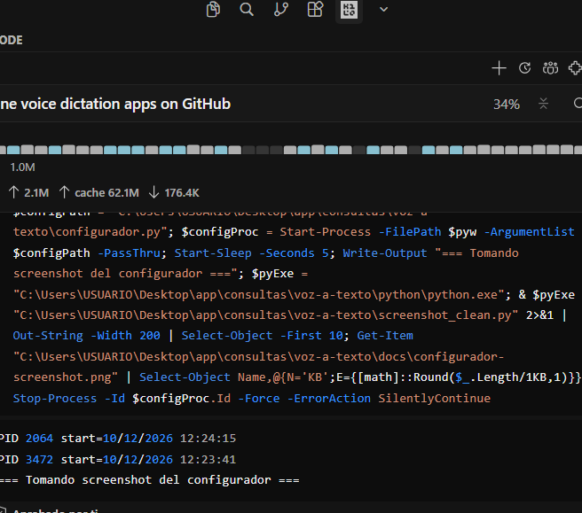

# 🎤 Dicto

> **Tu voz. Cualquier app. En un click.**

App de **dictado por voz** que escribe donde esté el cursor. Funciona en **Word, Excel, navegador, VS Code, chat, cualquier app de Windows**. Open source, gratis, pensado para correr en PCs con pocos recursos.


## 📥 Download (elige uno)

| Archivo | Tamaño | Descripción |
|---|---|---|
| **[Dicto-completo-v1.0.0.zip](https://github.com/DASILVALEO/Dicto/releases/latest)** | **58 MB** | ✅ Recomendado. Incluye Python 3.12 + todas las dependencias. No necesitas instalar nada más. |
| [Dicto-ligero-v1.0.0.zip](https://github.com/DASILVALEO/Dicto/releases/latest) | 380 KB | Solo código fuente. Requiere Python 3.10+ ya instalado. Descarga más rápida. |

---

## ✨ ¿Por qué Dicto?

Las apps de dictado actuales tienen un problema: asumen que tienes una PC moderna. La realidad es que millones de personas dictan desde laptops con 4 GB de RAM, CPUs de 2011, sin internet confiable.

**Dicto está diseñado para correr donde otros no pueden.**

| Característica | Detalle |
|---|---|
| 🧠 **IA de verdad** | MiniMax/IA (nube) o Vosk (offline) — ambos en español nativo |
| 💾 **Solo 4 GB RAM** | No necesitas 8-16 GB como Dragon o Wispr |
| 🐢 **CPU antigua OK** | Funciona en Sandy Bridge 2011, Ivy Bridge 2012 (sin AVX2) |
| 🌐 **Online u Offline** | Nube para mejor calidad, offline para privacidad |
| 🔓 **Open source** | MIT — usa, modifica, comparte |
| 💰 **Gratis** | Sin suscripción, sin telemetría, sin cuentas obligatorias |
| ⌨️ **Hotkey global** | Una tecla dicta en cualquier app |
| 🎤 **VU meter** | Ves el nivel de tu voz en tiempo real |
| 🪟 **Multi-app** | Word, Excel, navegador, VS Code, chat, donde sea |

---

## 🎯 Demo

```
┌────────────────────────────────────────────┐
│ ●  ████████████░░░░░░░░░░░░░░░  3s         │  ← Overlay flotante
└────────────────────────────────────────────┘
    ↑
    VU meter verde en vivo + cronómetro

[Windows]  [Word]  [Excel]  [VSCode]  [Chrome]  [Telegram]  [Discord]
       ↓        ↓       ↓        ↓         ↓           ↓          ↓
      [Texto aparece donde está el cursor]    ← Funciona en TODAS
```

---

## 🖼️ Configurador

Doble-click en **"Configurador Dicto"** del escritorio. Panel con 3 pestañas:



### Pestañas disponibles

| Pestaña | Qué hace |
|---|---|
| 🔑 **API Keys** | Configura MiniMax/IA, Groq, OpenAI o Vosk. Botón "Probar conexión" por proveedor |
| ⚙️ **Comportamiento** | Hotkey, idioma, auto-paste |
| 📊 **Estado** | Ver proceso, auto-inicio, reiniciar watchdog, abrir config JSON |

---

## 🚀 Quick start (60 segundos)

```powershell
# 1. Instala Python 3.10+ (marca "Add to PATH"): https://python.org/downloads
# 2. Descarga Dicto (botón verde "Code" → Download ZIP) o clona:
git clone https://github.com/DASILVALEO/Dicto.git
cd Dicto

# 3. Doble-click en install.bat
# 4. Pega tu API key de MiniMax/IA cuando lo pida
# 5. Listo. Abre Word, pulsa Alt Gr, habla 🎤
```

**¿No tienes cuenta de MiniMax/IA?** Usa **Vosk offline** — funciona sin internet y sin API key (dicata en español sin más).

---

## 📦 Requisitos

| | Mínimo | Recomendado |
|---|---|---|
| **OS** | Windows 10 (1809+) | Windows 10/11 LTSC |
| **RAM** | **4 GB** ✅ | 8 GB+ |
| **CPU** | Cualquier x86_64 (incluso Sandy Bridge 2011) | Moderno (Haswell+ para Vosk rápido) |
| **Disco** | 200 MB | 500 MB |
| **Internet** | Solo si usas nube (MiniMax/IA, Groq, OpenAI) | No necesario con Vosk |
| **Micrófono** | Cualquiera | Integrado o USB |

> 🧪 **Probado en**: MacBook Air Sandy Bridge (i5-2557M, 4GB RAM, Win 10 LTSC vía Boot Camp). Funciona perfectamente.

---

## 🤖 Proveedores de transcripción

Dicto soporta múltiples proveedores. Cambia entre ellos cuando quieras desde el Configurador.

### ☁️ Nube (mejor calidad)

| Proveedor | Calidad | Costo | Setup |
|---|---|---|---|
| **MiniMax/IA** | ⭐⭐⭐⭐⭐ | Free tier generoso | https://platform.minimax.io |
| **Groq** | ⭐⭐⭐⭐⭐ | Free tier | https://console.groq.com/keys |
| **OpenAI** | ⭐⭐⭐⭐⭐ | ~$0.006/min (1¢/min) | https://platform.openai.com |

### 🌑 Offline (sin internet, gratis)

| Proveedor | Calidad | Costo | Modelo |
|---|---|---|---|
| **Vosk** | ⭐⭐⭐⭐ | Gratis | 57 MB, español nativo |

---

## 🎮 Cómo se usa

1. **Abre cualquier app** (Word, navegador, chat, editor de código, Excel, Bloc de notas...)
2. **Pon el cursor** donde quieras escribir
3. **Pulsa `Alt Gr`** (Alt derecha) — una vez
4. **Aparece una barrita flotante** 🎤 con VU meter en vivo
5. **Habla en español**
6. **Pulsa `Alt Gr`** otra vez — el texto se pega donde está el cursor ✨

### Atajos incluidos

| Atajo | Acción |
|---|---|
| `Alt Gr` (mantener o pulsar) | Empezar/terminar dictado |
| `Ctrl + Alt + Q` | Salir de la app |

Personalizables desde el **Configurador**.

---

## 🏗️ Arquitectura

```
[Tecla Alt Gr] ──► [keyboard.hook] ──► [sounddevice]
                                              │
                                              â–¼
                                  [WAV 16kHz mono]
                                              │
                          ┌───────────────────┴──────────────┐
                          â–¼                                  â–¼
                  [API nube (MiniMax/IA)]            [Vosk local]
                          │                                  │
                          └──────────────┬───────────────────┘
                                         â–¼
                                  [texto transcrito]
                                         │
                                         â–¼
                            [pyperclip + Ctrl+V]
                                         │
                                         â–¼
                              [texto en el cursor] ✓

[Overlay Tkinter] ◄──── estado + VU meter en vivo
[Watchdog .bat]   ◄──── reinicia la app cada 3 min
```

**~200 líneas** de código Python. Sin Electron, sin Tauri, sin Chromium. Pura Python + Windows nativo.

---

## 🔧 Troubleshooting

**El micro no se abre** → Verifica que el micrófono predeterminado funcione en Configuración de Windows > Sonido > Entrada.

**MiniMax/IA devuelve error** → Tu API key expiró. Abre el **Configurador** y pega la nueva.

**La hotkey no responde** → Si usas Mac con Boot Camp, presiona **Alt derecha** (no izquierda). Si sigue sin ir, prueba `f12` o `right ctrl` desde el Configurador.

**La app no inicia al prender la PC** → Abre el **Configurador → Estado** para verificar el auto-inicio.

---

## 🌟 ¿Por qué lo hice?

La primera vez que probé apps de dictado en mi MacBook Air del 2011 (4 GB RAM, Sandy Bridge), todas fallaron. SpeakoFlow crasheaba, whisper-local no cargaba, SayIt requería DLLs faltantes.

Luego descubrí que necesitaba CPU con AVX2 (2017+) y 8+ GB de RAM. Pero muchos usuarios no tienen eso.

**Dicto es para ellos.** Y también para mí.

---

## 🤝 Contribuir

Pull requests bienvenidos. Áreas abiertas:
- Soporte para más idiomas en Vosk
- Cancelación de ruido (RNNoise)
- Icono en system tray para config rápido
- Auto-detección de contexto (chat vs editor)
- Empaquetado como `.exe` standalone con PyInstaller

---

## 📄 Licencia

MIT — usa, modifica, redistribuye libremente. Si haces algo cool con esto, contame.

---

## 🙏 Inspirado en

- [Wispr Flow](https://wispr.com) — UX pulida
- [Dragon](https://nuance.com/dragon) — dictado profesional
- [Superwhisper](https://superwhisper.com) — simplicidad
- [Talon](https://talonvoice.com) — open source
- [Vosk](https://alphacephei.com/vosk) — motor ASR offline

---

## ⭐ Dale una estrella

Si Dicto te ahorra tiempo, dejá una ⭐ en GitHub — ayuda mucho a que más gente lo descubra.

**[⬇️ Descarga la última versión](https://github.com/DASILVALEO/Dicto/releases)**


